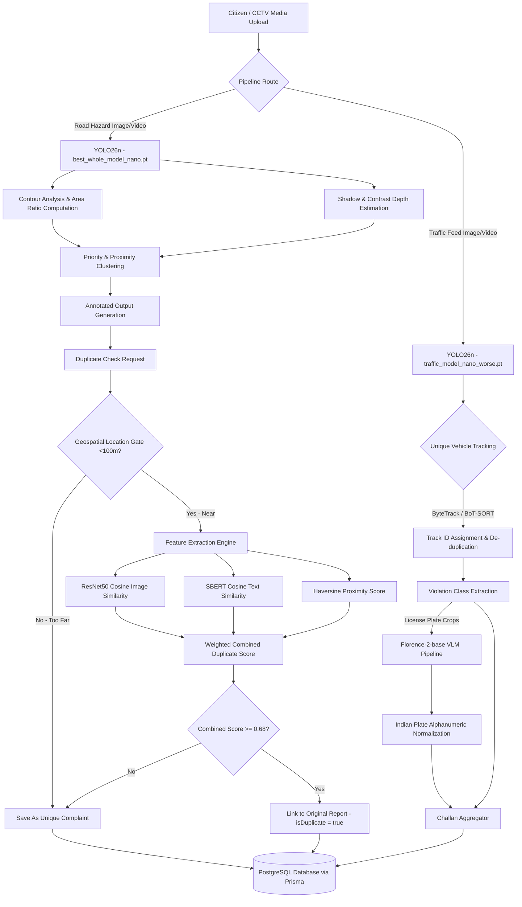

# 🛣️ SadakSathi - AI-Powered Road Intelligence & Traffic Enforcement

[](https://fastapi.tiangolo.com)
[](https://nextjs.org)
[](https://pytorch.org)
[](https://www.postgresql.org)
[](https://www.prisma.io)

An AI-powered civic road intelligence and traffic enforcement platform that leverages multi-class object detection, multi-object tracking in video, geospatial indexing, and multimodal duplicate suppression to help cities respond to road hazards and traffic violations.

---

## ⚡ Executive Summary (The 30-Second Review)

If you are a recruiter or hiring manager reviewing this repository, here is the technical complexity in a nutshell:

| Core Engineering Dimension | Implementation Details |
| :--- | :--- |
| **System Architecture** | **Decoupled Dual-Server**: Next.js App Router full-stack web/API server + independent FastAPI ML inference engine serving local neural pipelines. |
| **Civic Road Detection** | **YOLO26n detector (`best_whole_model_nano.pt`)** with custom individual priority scoring based on bounding contour area ratio and gray-level shadow-contrast depth heuristics. |
| **Traffic Enforcement** | **YOLO26n violation detector (`traffic_model_nano_worse.pt`)** integrated with **ByteTrack / BoT-SORT** trackers to de-duplicate moving violations by persistent `track_id`. |
| **Multimodal Duplication Engine** | **Deterministic Threshold Gating (v2)**: Catches duplicate citizen reports in about **60 ms** per check on a laptop CPU, using a spatial hash grid pre-filter, ResNet50 visual embeddings, SBERT semantic text similarity, and Haversine scoring. |
| **License Plate OCR** | **Florence-2-base VLM** (`microsoft/Florence-2-base`) running custom greedy decode pipelines. OCR is restricted to **exactly once per tracked vehicle ID**, so a vehicle seen in 100 frames is read once, not 100 times. |

### 🚀 Key Technical Achievements
*   **Zero-Overhead Gating:** Coarse spatial grid index filters out candidate reports $>100\text{m}$ away in $O(1)$ time, skipping expensive neural embedding extraction.
*   **Florence-2 PyTorch Patching:** Custom VLM loading routine using eager attention graphs (`attn_implementation="eager"`) and cached execution blocks (`use_cache=False`) to run VLM models stably on CPU-optimized PyTorch 2.2.2 runtimes.
*   **No Failures in the Duplicate Test Suite:** The duplication engine passes all 87 graded cases of a 100-report suite covering identical, near-duplicate, paraphrased, cross-class, and remote-location reports. The other 13 are borderline cases that are logged, not graded.

---

## 🛠️ Engineering Challenges Solved

### 1. Heavy VLM CPU Latency Optimization
> [!IMPORTANT]
> **Challenge:** Vision Language Models (like Microsoft's Florence-2-base) read plates far better than small ONNX readers (in a small test on Indian plates, Florence-2 read 3 of 4 exactly, where a CCT-based ONNX reader managed about 13%), but greedy VLM generation takes ~1.6 seconds on standard CPU nodes. Triggering OCR on every single video frame creates massive execution bottlenecks.
>
> **Solution:** A **de-duplicated tracking-to-OCR bridge** was engineered. By pairing the YOLO vehicle model with a persistent tracker (`ByteTrack` or `BoT-SORT`), the VLM OCR engine is triggered **exactly once per unique tracking ID** instead of once per frame. The resulting alphanumeric text is cached in the active tracking dict, so OCR cost grows with the number of vehicles, not the number of frames. Video comes from uploaded files; live camera streams are not supported.

### 2. Eliminating Rust-Binary Compilation Failures on Serverless CPU
> [!TIP]
> **Challenge:** Many serverless platforms (like Render or Railway) fail when compiling dependencies with heavy underlying C++/Rust binaries (such as EasyOCR or python-bidi $\ge 0.6$ compilation wheels).
>
> **Solution:** The system's OCR architecture was redesigned to rely on **pure-Python Hugging Face transformers** loading Florence-2. Dependencies were tightly pinned to `python-bidi==0.4.2` and pure-Python packages. This ensured clean, headless Docker compilations and eliminated dependency compilation issues on remote hosting containers.

### 3. Resolving PyTorch 2.2.2 Transformer Attribute Mismatches
> [!WARNING]
> **Challenge:** Standard PyTorch CPU-only wheels (specifically `torch==2.2.2+cpu`) lack the newer scaled dot-product attention (SDPA) attributes expected by latest Hugging Face remote configuration scripts, which caused the Florence-2 VLM model to crash on startup.
>
> **Solution:** The model loading routine was patched to explicitly override graph-optimization layers:
> ```python
> AutoModelForCausalLM.from_pretrained(
>     model_id,
>     attn_implementation="eager",  # Bypass SDPA execution graph checks
>     use_cache=False,              # Fix remote modeling KV-cache compat
>     trust_remote_code=True
> ).to(device)
> ```
> This configuration allows the model to initialize and run stably on older local or container CPU environments.

---

## 🎯 Why This Project Matters

**sadakSathi** represents a practical approach to real-world AI applications:
*   **Zero External API Expenses:** Bypasses costly cloud APIs (like OpenAI or Google Cloud Vision) by serving local, specialized neural networks (YOLO26n + Florence-2 base VLM) directly inside a FastAPI container.
*   **Spam Suppression at Scale:** Prevents ticket duplication using a highly optimized, multimodal, deterministic threshold pipeline ($O(1)$ spatial hash grid pre-filter, ResNet50 visual embeddings, SBERT semantic text similarity) to block redundant reports.
*   **Production-Grade Decoupling:** Decouples CPU-heavy AI model inference from transactional web routes. Next.js handles user sessions, upvotes, and dashboard interfaces, while FastAPI manages neural networks and coordinate geometry checks.

---

## 📖 Problem Statement

Modern cities suffer from fragmented infrastructure maintenance and high rates of unpenalized traffic violations. Citizen hazard reporting is often plagued by redundant submissions of the same issue (creating ticket noise for municipal crews) and lacks objective priority sorting. Concurrently, traffic enforcement agencies struggle to scale monitoring systems for safety violations like triple-riding, riding without helmets, and wrong-side driving. 

**sadakSathi** bridges these gaps by providing an automated, AI-driven civic reporting portal and traffic enforcement suite. By detecting road hazards in uploaded photos and video, de-duplicating redundant citizen complaints, and automating number plate OCR and violation tracking in uploaded CCTV/dashcam footage, the platform transforms raw visual data into structured municipal action.

---

## 🌟 Core Capabilities

### 🚧 Road Hazard Detection
Uses a highly optimized YOLO-based model (`best_whole_model_nano.pt`) with a custom priority estimation heuristic. The platform detects potholes, garbage piles, overflowing garbage, broken or open manholes, and fallen trees. It ranks hazard severity from contour area ratios and a shadow-contrast depth estimate, so staff can fix the worst damage first.

### 🔍 Duplicate Report Detection (v2)
Prevents ticket fatigue by screening incoming complaints against existing reports using a deterministic, multi-modal threshold algorithm. By pairing Sentence-BERT (SBERT) text embeddings and ResNet50 visual embeddings with Haversine geospatial proximity gating, the engine passes every graded case in the project's test suite, at about 60 ms per check on a laptop CPU.

How it is used: when a complaint is filed, the web app first applies a persistent rule (same issue type within 100 m in the last 30 days). If that finds nothing, it asks this engine (text + photo + location, 5 s timeout) and then adds the new report to the engine's index. If the ML server is down, the location rule still applies. The engine's index is in memory, so it starts empty after a restart.

### 📝 License Plate Recognition (OCR)
Integrates Microsoft’s Florence-2-base Vision Language Model (VLM). Crop coordinates generated by the YOLO traffic pipeline are passed directly to Florence-2, which reads the plate text with a greedy decode, so traffic staff can issue e-challans without typing plates by hand. Small or blurry plates may be read only partly. OCR can be switched off with `OCR_ENABLED=false`.

### 📱 Citizen Reporting
Empowers citizens to log complaints, upload evidence (photos/videos), and track resolving steps. Integrated community-upvoting mechanics prioritize highly-voted issues in the public feed, while gamification leaderboards incentivize civic engagement.

### 🏛️ Administrative Dashboard
Gives municipal staff and traffic police their own desks. Municipal staff change complaint status, add remarks, view summary charts and chat with the citizen who reported. Traffic police review AI-flagged violations and issue challans, with the fine set by violation type.

---

## 🗺️ AI System Architecture



---

## 🧠 Detection Pipeline & Workflows

The core image and video inference pipeline runs on the FastAPI backend, using small "nano" YOLO models so it stays usable on a CPU.

### Model Weights
*   **Road Hazard Detector (`best_whole_model_nano.pt`):** YOLO26n, mAP50 0.81 on its validation set. Runs at a confidence threshold of `0.20`.
*   **Traffic Violation Detector (`traffic_model_nano_worse.pt`):** YOLO26n trained for helmets, triple riding and number plates.

### Classes Detected
These are the classes inside the bundled weights (checked with `YOLO(path).names`):
*   **Road Hazards:** `pothole`, `garbage`, `garbage_overflow`, `manhole_broken`, `manhole_lose`, `manhole_uncovered`, `fallen_tree`
*   **Traffic:** `Plate`, `WithHelmet`, `WithoutHelmet`, `TripleRiding`

The code also maps `broken_sign`, `broken_street_light`, `wrong_side_moving` and vehicle classes, but those need other weights (set `MODEL_PATH` / `TRAFFIC_MODEL_PATH`). **Wrong-side driving is not detected with the bundled traffic model.**

### Inference & Severity Workflows

#### 1. Individual Detection Assessment
For each road hazard box, a custom contour is extracted. The system calculates:
$$\text{Area Ratio} = \frac{\text{Contour Area}}{\text{Total Image Area}}$$
A heuristic **Depth Score** ($0.0 \text{ to } 1.0$) is calculated via shadow analysis in the grayscale space:
$$\text{Depth Score} = 0.7 \times (1.0 - \text{Mean Brightness}) + 0.3 \times \text{Standard Deviation Contrast}$$
These metrics are mapped to an individual priority pill (`High`, `Medium`, `Low`). Safety-critical classes are guaranteed minimum priorities via class overrides:
*   `manhole_cover` $\rightarrow$ Minimum priority: **High**
*   `broken_sign`, `broken_street_light`, `overflow_garbage` $\rightarrow$ Minimum priority: **Medium**

#### 2. Group & Proximity Clustering
For images containing multiple hazards, an in-memory hierarchical proximity cluster identifies compounding issues within a `150px` pixel radius. Hulls are drawn around dense hazard areas on the output image. If $\ge 2$ High-severity hazards or any 3+ hazard clusters are found, the overall road priority is elevated to **High**.

---

## 🔍 Duplicate Detection Engine Details

To cut ticket spam, sadakSathi features a multi-modal de-duplication engine.

### Signal Score Formulation
1.  **Visual Similarity ($S_{\text{img}}$):** Uses ResNet50 (pre-classification layer) to extract a $2048$-dimensional feature vector from the uploaded image. If no image is provided, a pure-Python BGR color-histogram fallback vector ($100$-dimensional) is generated. The score is computed using Cosine Similarity:
    $$S_{\text{img}} = \max\left(0, \frac{\mathbf{v}_A \cdot \mathbf{v}_B}{\|\mathbf{v}_A\| \|\mathbf{v}_B\|}\right)$$
2.  **Textual Similarity ($S_{\text{text}}$):** Generates a dense $384$-dimensional sentence vector using the `SentenceTransformer` framework (`paraphrase-MiniLM-L6-v2`).
    $$S_{\text{text}} = \max\left(0, \frac{\mathbf{t}_A \cdot \mathbf{t}_B}{\|\mathbf{t}_A\| \|\mathbf{t}_B\|}\right)$$
3.  **Spatial Score ($S_{\text{loc}}$):** Calculated using the Haversine distance ($D_{\text{km}}$) between coordinates:
    $$S_{\text{loc}} = 1.0 - \min\left(1.0, \frac{D_{\text{km}}}{\text{Gate Radius (0.10 km)}}\right)$$

### Decision Logic & Penalties
The combined duplicate index ($S_{\text{dup}}$) is computed via:
$$S_{\text{dup}} = \frac{0.25 \cdot S_{\text{img}} + 0.40 \cdot S_{\text{text}} + 0.35 \cdot S_{\text{loc}}}{0.25 + 0.40 + 0.35}$$
*   **Duplicate Threshold:** Any submission scoring $\ge 0.68$ is flagged as a duplicate (`isDuplicate = true`) and linked directly to the parent complaint via the `originalReportId` key.
*   **Spatial Gating:** Reports farther than `100 meters` are immediately skipped, saving CPU cycles on downstream vector extractions.
*   **Image Weight Penalty:** Text-only reports (no image provided) have $S_{\text{img}}$ set to `0.0`, limiting the maximum achievable $S_{\text{dup}}$ to `0.75`. This ensures that text-only complaints require near-identical SBERT similarity and extremely close proximity ($\le 5\text{m}$) to be marked as duplicates, mitigating false positives.

### Core Database Indexes
To maintain search speeds as the database grows, the engine maps incoming lat/lon pairs into a spatial hash grid index:
$$\text{Grid Cell} = \left( \lfloor \frac{\text{Latitude}}{\text{Grid Size}} \rfloor, \lfloor \frac{\text{Longitude}}{\text{Grid Size}} \rfloor \right)$$
Candidates are retrieved in an $O(1)$ lookup containing the target grid cell and its 8 neighboring cells, removing the need for computationally heavy $O(N)$ full database scans.

---

## 📈 Performance Metrics

Measured in November 2026 on a 20-thread laptop CPU with no GPU, with the web app and ML server running. Your numbers will differ with hardware; re-run the commands to check.

*   **Road Hazard Detection:** about `0.3 s` median per photo, from upload to result, including priority scoring and the marked-up image (10 timed runs against `POST /detect/image`).
*   **Road Model Accuracy:** mAP50 `0.81` on its validation set.
*   **Duplicate Check:** `62 ms` median, `76 ms` mean per check in `tests/test_duplication_100.py`.
*   **Duplicate Detection Validation:** 87 of 87 graded cases pass, 0 fail, in the 100-report suite (`tests/test_duplication_100.py`). The other 13 are borderline cases that are logged, not graded.
*   **Florence-2 OCR:** 3 of 4 test plates read exactly, the fourth partly (a tiny crop); about `1.6 s` per plate on a CPU. This is a small sample, so expect misses.
*   **Not measured:** video tracking speed and GPU speed.

---

## 📊 Database Design

The system uses a PostgreSQL database, managed through Prisma ORM.

```
                  ┌─────────────────┐
                  │      User       │
                  └─────────┬───────┘
                            │ 1
                            │
                            │ 1..*
                  ┌─────────▼───────┐
                  │    Complaint    │◄───────────────┐
                  └─────────┬───────┘                │
                            │ 1                      │ 1
                            │                        │
                            ├─────────────────┐      │
                            │ 1..*            │ 1..* │ 0..1
                  ┌─────────▼───────┐┌────────▼─┐┌───┴─────────────┐
                  │ DetectionResult ││  Upvote  ││    Feedback     │
                  └─────────────────┘└──────────┘└─────────────────┘

 ┌──────────────────┐           ┌──────────────────┐           ┌───────────┐
 │ VehicleDetection │──────────►│ TrafficViolation │──────────►│  Challan  │
 └──────────────────┘ 1      *  └──────────────────┘ 1      1  └───────────┘
```

<details>
<summary><b>📂 Click to View Detailed Prisma Models Overview</b></summary>

*   **User:** Contains account information, avatars (saved as text-based URIs), geographic details (city, state), and points for civic gamification. One-to-many relationship with `Complaint`, `Feedback`, `Upvote`, and auditing logs (`UserActivity`).
*   **Complaint:** Citizen-reported road issues. Contains coordinates, addresses, and state variables (`isDuplicate` and `originalReportId` to hook into the duplicate detection pipeline).
*   **DetectionResult:** Saved outputs from the YOLO road-hazard model. Links back to the `Complaint` record and contains a raw `Json` field (`payload`) storing coordinates, confidence scores, and individual class priority assignments.
*   **VehicleDetection & TrafficViolation:** Tracked vehicles from the CCTV traffic pipelines are saved in `VehicleDetection`. Any detected violation (helmet, triple riding) references a `VehicleDetection` parent ID.
*   **Challan:** Integrates directly with the `TrafficViolation` model via a one-to-one relationship. Automatically maps fine amounts based on the violation type.
</details>

---

## 💻 Tech Stack & Repository Structure

| Layer | Technology | Version | Key Application |
|---|---|---|---|
| **Frontend Framework** | Next.js (App Router) | `16.1.6` | Client views, server-side page hydration |
| **User Interface** | React | `19.2.3` | Responsive layout, optimistic state management |
| **Styling** | Tailwind CSS / PostCSS | `^4` | Glassmorphic cards, dashboard layouts |
| **Database Engine** | PostgreSQL | — | Persistent data, transactional security |
| **ORM** | Prisma | `7.3.0` | Schema migrations, database operations |
| **Auth & Security** | JWT (`jose`) + `bcryptjs` | — | Secure httpOnly cookies, password hashing |
| **Server Framework** | FastAPI (Python) | `^0.115.0` | Heavy machine learning endpoints, vector checks |
| **Core AI Framework** | PyTorch (CPU-optimized) | `2.2.2+cpu` | Neural network backend |
| **Object Detection** | Ultralytics YOLO26 | `>=8.4.0` | Bundled YOLO26n road and traffic models |
| **VLM & OCR** | Transformers (Florence-2) | `^4.40.0` | License plate character extraction |
| **NLP Embeddings** | Sentence-Transformers | `^3.0.0` | SBERT paraphrase semantic vectors |
| **Geospatial Engine** | Geopy | `^2.4.0` | Haversine distance computations |

<details>
<summary><b>📂 Click to View Full Repository Directory Tree</b></summary>

```
sadakSathi/
├── prisma/
│   └── schema.prisma         # Prisma Schema: Models and Enums
├── src/
│   ├── app/                  # Next.js App Router Pages & API Routes
│   │   ├── api/
│   │   │   ├── auth/         # JWT Login, Signup, Logout, Google OAuth
│   │   │   ├── complaints/   # Complaint Creation, Public Feed, Upvotes
│   │   │   └── traffic/      # Challan Actions, Traffic Aggregates
│   │   ├── dashboard/        # Citizen Dashboard & Authority Portal Views
│   │   ├── complaints/       # Citizen Reporting Feed
│   │   └── upload/           # Media Upload Page & Live ML Previews
│   │   └── page.tsx          # Landing Page
│   ├── components/           # Reusable React components
│   │   ├── dashboard/        # Welcome Banners, Status Badges, Chat Modals
│   │   ├── traffic/          # Detection Stream Tables, Challan Modals
│   │   └── account/          # Profile Forms, Activity Tables
│   ├── lib/                  # Frontend Core Library
│   │   ├── api-client.ts     # Client Fetch Wrapper with error handling
│   │   ├── auth.ts           # Hashing helper wrappers
│   │   └── prisma.ts         # Prisma Client Singleton instantiation
│   └── proxy.ts              # Route-Protection Middleware (JWT gate)
├── backend/
│   ├── main.py               # FastAPI App Lifespan and Route Configuration
│   ├── config.py             # Pydantic Settings, Class Overrides, Path Config
│   ├── ml/                   # Machine Learning Module
│   │   ├── detection.py      # Road Hazard inference & shadow depth heuristics
│   │   ├── duplication.py    # Geospatial spatial grid & vector similarity
│   │   ├── plate_ocr.py      # Florence-2 crop & OCR parsing pipeline
│   │   └── traffic.py        # Violation tracking (ByteTrack)
│   ├── routers/              # FastAPI Routers
│   │   ├── health.py         # GPU & Model health probe
│   │   ├── detection.py      # Road Hazard endpoints (/detect/image, /video)
│   │   ├── traffic.py        # Violation tracking endpoints (/detect/traffic)
│   │   ├── duplication.py    # Duplicate check endpoints (/duplicate/check)
│   └── tests/                # Suite & Integration Verification
│       ├── test_duplication_100.py   # 100-report deterministic suite
│       └── test_florence_ocr.py       # Indian plate VLM validation checks
```
</details>

---

## 🔌 API Documentation

<details>
<summary><b>📂 Click to View REST API Specifications</b></summary>

### FastAPI ML Services

#### 1. Road Hazard Image Assessment
*   **Endpoint:** `POST /detect/image`
*   **Request Type:** `multipart/form-data`
*   **Parameters:**
    *   `file`: `UploadFile` (Required)
    *   `conf_threshold`: `float` (Default: `0.20` - tuned for `best_whole_model_nano.pt`)
    *   `include_annotated`: `bool` (Default: `True` - returns base64 annotated image)
*   **Success Response (200 OK):**
    ```json
    {
      "success": true,
      "total_detections": 1,
      "road_priority": "High",
      "detections": [
        {
          "id": 0,
          "class_name": "manhole_cover",
          "confidence": 0.8951,
          "bbox": { "x1": 120, "y1": 340, "x2": 280, "y2": 500 },
          "area_pixels": 25600,
          "area_ratio": 0.025,
          "depth_score": 0.78,
          "priority": "High"
        }
      ],
      "priority_counts": { "High": 1 },
      "annotated_image_base64": "iVBORw0KGgoAAA...",
      "message": "Detected 1 hazard(s)."
    }
    ```

#### 2. Traffic Violation Assessment (Uploaded Video)
*   **Endpoint:** `POST /detect/traffic/video`
*   **Request Type:** `multipart/form-data`
*   **Parameters:**
    *   `file`: `UploadFile` (Required video file)
    *   `conf_threshold`: `float` (Default: `0.25`)
    *   `tracker`: `string` (Options: `bytetrack.yaml` | `botsort.yaml`)
    *   `run_ocr`: `bool` (Default: `True`)
*   **Success Response (200 OK):**
    ```json
    {
      "success": true,
      "total_frames_analyzed": 120,
      "total_frames": 120,
      "total_detections": 340,
      "unique_tracked_violations": 1,
      "violations": [
        {
          "track_id": 4,
          "class_name": "no_helmet",
          "display_name": "No Helmet",
          "priority": "High",
          "first_seen_frame": 12,
          "first_seen_sec": 0.4,
          "confidence": 0.912,
          "plate_text": "MH 12 AB 1234"
        }
      ],
      "summary": {
        "class_counts": { "no_helmet": 90, "number_plate": 120, "motorcycle": 130 },
        "priority_counts": { "High": 90, "Medium": 120, "Low": 130 },
        "fps": 30.0,
        "tracker": "bytetrack.yaml"
      },
      "message": "Analyzed 120 frames - found 1 unique violation(s) (340 raw detections)."
    }
    ```

#### 3. Duplicate Complaint Check
*   **Endpoint:** `POST /duplicate/check`
*   **Request Body (`application/json`):**
    ```json
    {
      "text": "Deep pothole filled with water near bus stop",
      "location": [21.1458, 79.0882],
      "issue_type": "pothole",
      "image_base64": "Optional base64 encoded string"
    }
    ```
*   **Success Response (200 OK):**
    ```json
    {
      "is_duplicate": true,
      "confidence": 0.724,
      "original_report_id": "cuid_of_original_complaint",
      "similar_reports": [
        {
          "id": "cuid_of_original_complaint",
          "text": "Large pothole on main road near bus stop causing accidents daily",
          "issue_type": "pothole",
          "location": [21.1458, 79.0882]
        }
      ]
    }
    ```
</details>

---

## 📘 User Guide

An animated, step-by-step guide is built into the app at **`/guide`** (also linked as "How it works" in the header and "User guide" in the footer). It has two tracks:

* **For citizens:** log in, scan a photo or video, read the detected hazards and their priority, send the report with its location, see how duplicates are linked, then track status, upvote and chat with the department.
* **For city staff:** the municipal desk (open a report, set status and remarks, mark duplicates, attach a resolution photo before completing, reply to citizens) and the traffic desk (review detected violations, plate read once per vehicle, issue a challan).

Each step has a looping animated scene of the real screen. Animations only run while on screen, can be paused with the "Pause animations" button, and show their final frame statically when the operating system's "reduce motion" setting is on.

---

## 🛠️ Setup (Windows and Linux)

Everything below works on both. Where the commands differ, both are shown.

### Prerequisites
* Node.js **20.12 or newer** (the scripts use Node's built-in `.env` loader)
* Python **3.12**
* PostgreSQL 14+ (any install; a no-installer option is shown below)

### 1. Configure environment files

```bash
cp .env.example .env
cp backend/.env.example backend/.env
```
On Windows PowerShell use `Copy-Item` instead of `cp`. Then fill in `.env`:

| Variable | What it is |
| :--- | :--- |
| `DATABASE_URL` | PostgreSQL connection string |
| `JWT_SECRET` | Signs login cookies. **Required in production** (the app refuses to start without it). Generate: `node -e "console.log(require('crypto').randomBytes(48).toString('base64url'))"` |
| `AUTHORITY_SEED_PASSWORD` | Password given to the seeded municipal and traffic staff accounts |
| `GOOGLE_CLIENT_ID` / `GOOGLE_CLIENT_SECRET` | Optional Google sign-in |
| `NEXT_PUBLIC_APP_URL` | Public URL of the web app (OAuth redirects) |
| `FASTAPI_BASE_URL` | Where the ML backend runs (default `http://127.0.0.1:8000`) |
| `ML_API_KEY` | Shared secret sent to the ML backend; must equal `ML_API_KEY` in `backend/.env`. Generate it like `JWT_SECRET`. |
| `CAPACITOR_SERVER_URL` | URL the Android app loads; empty uses the bundled files |

`backend/.env` holds the ML settings:

| Variable | Default | What it does |
| :--- | :--- | :--- |
| `ML_API_KEY` | empty | Required `X-API-Key` on every endpoint except `/health`. **Set it whenever the ML server is reachable from the internet**; empty leaves it open (local development only, a warning is logged). |
| `OCR_ENABLED` | `true` | `true` loads Florence-2 and reads number plates (~1 GB RAM, ~1.6 s per plate on CPU). `false` skips loading it: plates are still detected, just not read. |
| `PARALLEL_PROCESSING` | `false` | `false`: one copy of each detection model, so requests for the same model run one at a time (least RAM). `true`: loads `PARALLEL_WORKERS` copies of each YOLO model so that many requests run at the same time. Florence OCR stays one shared copy either way. |
| `PARALLEL_WORKERS` | `2` | Copies per model when parallel processing is on (each adds roughly 50–100 MB of RAM). |
| `DEVICE` | `auto` | `auto`, `cpu` or `cuda`. |
| `TRACKER` | `bytetrack.yaml` | Default tracker for traffic videos (`botsort.yaml` is the alternative). |
| `MODEL_PATH` / `TRAFFIC_MODEL_PATH` | committed weights | Use other YOLO weights. |
| `DEBUG` | `false` | `true` also serves the interactive API docs at `/docs` (keep it off in production). |

`GET /health` reports `ocr_enabled`, `ocr_loaded` and `parallel_workers`, so you can confirm what is active. Both `.env` files are gitignored; only the `.env.example` files are committed.

### 2. PostgreSQL

Use an existing server, or run a portable one without an installer:

* **Windows:** download the "binaries" zip from [EnterpriseDB](https://www.enterprisedb.com/download-postgresql-binaries), extract it (for example to `C:\pgsql`), then:
  ```powershell
  C:\pgsql\bin\initdb.exe -D C:\pgsql\data -U postgres -W -A scram-sha-256 -E UTF8
  C:\pgsql\bin\pg_ctl.exe -D C:\pgsql\data -l C:\pgsql\server.log start
  C:\pgsql\bin\createdb.exe -U postgres sadaksathi
  ```
* **Linux (Debian/Ubuntu):**
  ```bash
  sudo apt install postgresql
  sudo -u postgres psql -c "ALTER USER postgres PASSWORD 'choose-a-password';"
  sudo -u postgres createdb sadaksathi
  ```

Put the password into `DATABASE_URL` in `.env`.

### 3. Web app (Next.js)

```bash
npm install                    # also runs prisma generate
npx prisma migrate deploy      # creates all tables
node seed-authorities.js       # creates the municipal and traffic staff accounts
npm run dev                    # http://localhost:3000
```

Staff log in on `/auth` with "Log in as: Municipal staff / Traffic police", using username `municipal_desk` or `traffic_desk` (or `municipal@sadaksathi.ai` / `traffic@sadaksathi.ai`) and the `AUTHORITY_SEED_PASSWORD` you set.

> **Upgrading an existing database** that was created with `prisma db push`: it already has the tables from the `20261118000100_sync_schema` migration. Mark it as applied instead of running it: `npx prisma migrate resolve --applied 20261118000100_sync_schema`, then `npx prisma migrate deploy`.

### 4. ML backend (FastAPI)

```bash
cd backend
python -m venv venv
```
Activate it with `source venv/bin/activate` on Linux, or `venv\Scripts\activate` on Windows. Then:
```bash
pip install -r requirements.txt     # CPU-only torch; versions are pinned to a working set
python -m uvicorn main:app --port 8000
```
Check `http://localhost:8000/health`: `model_loaded`, `traffic_model_loaded` and `ocr_loaded` should be `true`. The first start downloads Florence-2 and the sentence-embedding model from Hugging Face (about 1 GB, once).

The committed weights load by default: `backend/models/best_whole_model_nano.pt` (road hazards) and `backend/models/traffic_model_nano_worse.pt` (traffic). Override them with `MODEL_PATH` / `TRAFFIC_MODEL_PATH` in `backend/.env`.

To try a model on one image without the servers: `python run_detection.py path/to/image.jpg`.

---

## 🍓 Deploy on a Raspberry Pi (HTTPS)

`docker-compose.yml` runs the whole system on a **Raspberry Pi 4 or 5 (64-bit Raspberry Pi OS, 4 GB+ RAM)** or any Linux server:

| Container | What it does | Reachable from the network? |
| :--- | :--- | :--- |
| `caddy` | HTTPS front door: certificates, HTTP→HTTPS redirect, gzip/zstd, upload size limits | **Yes**: ports 80/443 only |
| `web` | Next.js standalone server (~80 MB RAM) | No (private Docker network) |
| `ml` | FastAPI + YOLO as NCNN models (fast on ARM), requires `ML_API_KEY` | No |
| `db` | PostgreSQL 17, tuned for small machines | No |
| `migrate` | Applies migrations and seeds staff accounts, then exits | No |

1. Install Docker: `curl -fsSL https://get.docker.com | sh`, then `sudo usermod -aG docker $USER` and log in again.
2. Copy the repo to the Pi, then `cp .env.example .env` and fill in `JWT_SECRET`, `ML_API_KEY`, `AUTHORITY_SEED_PASSWORD`, `POSTGRES_PASSWORD` and the **Deployment** block:
   * **Home network:** `SITE_ADDRESS=raspberrypi.local` and `CADDY_TLS=internal`. Caddy runs its own certificate authority; install its root certificate (`docker compose exec caddy cat /data/caddy/pki/authorities/local/root.crt`) on your devices to remove the browser warning.
   * **Public domain:** point the domain at your router, forward ports 80 and 443 to the Pi, then set `SITE_ADDRESS=your.domain` and `CADDY_TLS=you@example.com`. You get a real Let's Encrypt certificate, renewed automatically.
3. Run `docker compose up -d --build`. The first build on a Pi takes 20–40 minutes; to save time, build on a PC with `docker buildx build --platform linux/arm64` and push.
4. Open `https://<SITE_ADDRESS>`.

**Tuned for the Pi:**
* YOLO weights are exported to NCNN at image build time. NCNN is the format Ultralytics recommends for ARM CPUs.
* Plate OCR is off by default (`OCR_ENABLED=false`). Florence-2 needs about 1 GB of RAM and takes several seconds per plate on ARM. Turn it on for a Pi 5 with 8 GB.
* One model copy (`PARALLEL_PROCESSING=false`), 4 inference threads (`ML_THREADS`), small Postgres buffers, and a Node heap cap.
* Fonts ship in the repo, so builds work offline.
* Measured idle footprint in testing (OCR off): ~360 MB RAM for the whole stack.

**Why the channel is secure:** browsers only ever talk to Caddy over TLS (HSTS is sent). The web app, ML server and database share a private Docker network that isn't published to the LAN. The web app authenticates to the ML server with `ML_API_KEY`, and session cookies are `Secure`, `HttpOnly` and `SameSite=Lax`.

---

## ✅ Testing

| Command | What it checks |
| :--- | :--- |
| `npm test` | Unit tests (auth, JWT secret guard, signup role) |
| `npx tsc --noEmit` | Type check |
| `cd backend && pytest tests` | Backend API, duplicate detection, OCR (OCR/model tests skip when torch or test images are missing) |
| `npm run test:e2e` | **End-to-end smoke test** against running servers (53 checks): signup and login, role checks, account lockout, sign-out of other sessions on password change, filing complaints, media URLs, duplicate flagging, simultaneous upvotes, chat, municipal desk (resolution photo required to complete), traffic desk, delete, and road/traffic detection through the web proxy (including stored violations and the ML API key). Needs PostgreSQL, the web app and the ML backend running. `E2E_SKIP_ML=1` skips the model checks; `WEB_URL` / `ML_URL` point it elsewhere. |

CI runs the unit, type and backend tests on both **Ubuntu and Windows**, plus the end-to-end test against a PostgreSQL service (ML checks skipped there).

---

## 🔒 Security notes

* Roles come only from the database: signup always creates a citizen, and staff accounts come from `seed-authorities.js`. There are no hard-coded logins.
* Every API call re-checks the session against the database (`src/lib/session.ts`), so a changed role or deleted account takes effect immediately, and **changing your password signs out every other session**.
* Five wrong passwords in a row lock the account for 15 minutes (stored in the database, so it holds across server instances).
* The ML backend only answers calls carrying the shared `ML_API_KEY`; the web app adds it server-side and it never reaches the browser.
* The ML backend has no CORS (browsers never call it) and hides `/docs` and `/openapi.json` unless `DEBUG=true`. The Hugging Face models it downloads are pinned to exact commits, so a changed upstream repo can't run new code on the server.
* State-changing API calls carrying another site's `Origin` header are refused (`src/proxy.ts`), on top of `SameSite=Lax` cookies.
* Abuse limits: 20 reports per account per day, 10 AI scans per account per minute, 5 sign-ups per IP per hour. Authors can't upvote their own reports, and duplicates earn no leaderboard points. The per-minute and per-IP limits are kept in memory, which is exact for a single server such as the Pi. The IP comes from `X-Forwarded-For` as set by Caddy, so don't expose the Next.js port directly.
* Login gives the same answer, in the same time, for unknown accounts, wrong passwords and Google-only accounts.
* Last review followed the [Strix](https://github.com/usestrix/strix) methodology. Remaining known risk: the pinned `torch`/`transformers` versions carry advisories that apply only when loading untrusted model files (this app loads only its own pinned models). Upgrading them requires moving off torch 2.2.2.
* Staff pages and APIs check the role on the server: municipal routes need `municipal`/`admin`, traffic routes `traffic`/`admin`, and chats are limited to the thread owner or the matching department.
* Google sign-in uses a `state` check. Login redirects only follow same-site paths.
* Every response sends HSTS, `X-Content-Type-Options`, `X-Frame-Options`, `Referrer-Policy`, `Permissions-Policy` and a framing CSP (see `next.config.ts`).
* Uploads are size-limited (evidence about 3 MB, avatars about 300 KB) and limited to JPEG/PNG/WebP/GIF images and MP4/WebM/MOV video (no SVG). Media is still stored as base64 in Postgres, but lists never carry it: they return `/api/complaints/<id>/media` URLs that the browser loads and caches per picture. Move media to object storage if uploads grow.

---

## 🎨 Design

The interface follows a "highway sign" system: sign green `#00704A` for actions, hazard amber `#F5B700` for anything waiting on someone, signal red `#C8102E` for urgent or destructive actions, and asphalt `#1F2328` for text, all set in Overpass (descended from Highway Gothic, the road-sign typeface). Status colours are the same everywhere: Submitted is amber, Approved/On hold neutral, Rejected red, Completed green. Motion is limited to a few moments (the landing sign rising, the detector's scan pass, the moving hazard stripe on high-priority results) and is switched off by the operating system's reduce-motion setting.

---

**SadakSathi** — Making cities safer, one road at a time.
